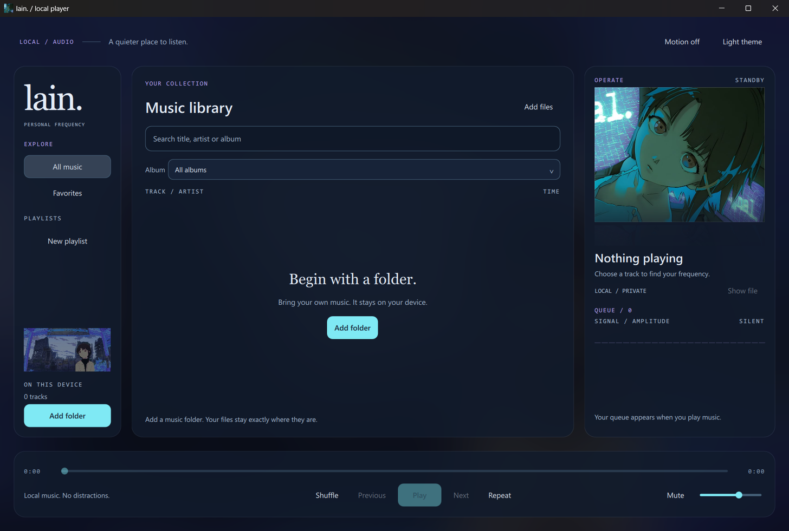

# EliLain Player

A quiet, native music player for the music already on your machine. Your Lain
artwork, a frosted glass interface, and a real mirrored cover — no account, no
API keys, no network calls at all.



## What it is

PySide6 + Qt Quick. Python owns scanning, persistence and audio decoding; QML
owns presentation. Playback is real Qt Multimedia decoding of your own local
files — nothing is streamed, re-encoded or uploaded.

## Features

- **Add folder or files** — recursive read-only scan with real mutagen tags for
  mp3, flac, wav, ogg, opus, m4a, aac, wma, aiff and alac.
- **Real playback** — play/pause, previous (restart after 3 s), next, queue
  with EndOfMedia advance, seek, volume, mute, shuffle, and repeat off/all/one.
- **Favorites and playlists** — persisted by stable track ID, so they survive
  search, view switches and rescans.
- **Real cover art** — embedded or sidecar artwork, cached locally as bounded
  JPEG; the Lain portrait is the fallback so nothing ever renders empty.
- **Now playing panel** — cover with a true vertical mirror reflection over the
  blurred scene, real title/artist/format/bitrate, and an amplitude meter fed by
  actual decoded PCM samples (zeros when paused, never a fake waveform).
- **Ambient detail** — hand-tuned dark and light themes, translucent panels over
  a real Gaussian-blurred backdrop image, and an optional motion toggle that is
  off by default.
- **Safe** — file-derived text always renders as plain text, so hostile tags
  cannot pull remote images. Removing a track removes it from your library only;
  the audio file is never deleted.

## Run it

Double-click `launch-player.bat`, or:

```bash
python -m elilain_player                  # normal launch
python -m elilain_player --doctor         # check Qt, audio devices, packaged art
python -m elilain_player --state-dir DIR  # isolated settings for verification
```

`launch-player-debug.bat` keeps the console visible for QML diagnostics.

## Keyboard

| Key | Action |
| --- | --- |
| `Space` | Play/pause (suppressed while typing) |
| `Ctrl O` / `Ctrl Shift O` | Add files / add folder |
| `Ctrl F` | Focus search |
| `Ctrl ←` / `Ctrl →` | Previous / next |
| `Ctrl T` | Toggle theme |
| `Esc` | Close overlays, or stop a running scan |

## Verification

74 tests pass; `ruff check .` is clean.

- `tests/test_library.py` — real WAV/MP3/FLAC/OGG/M4A/WMA/AIFF fixtures,
  corrupt and zero-byte files, junction loops, corrupt JSON recovery, artwork
  bounds, 3000-track reload.
- `tests/test_playback.py` — real Qt audio decoding, pause, seek, queue
  navigation, EndOfMedia advance, shuffle, repeat, real decoded levels.
- `tests/test_controller.py` — search must not mutate the running queue, plus a
  real QThread import with deferred close and cancellation.
- `tests/test_qml_design.py` — 23 native acceptance tests: real QML engine,
  zero diagnostics, containment inside cards, control reachability, themes.

Render real pixels and a real backend run:

```bash
python tools/render_player.py out/ --music /path/to/a/music/folder
```

## Known limits

- **WMA cover art is not extracted** — mutagen has no `WM/Picture` API, so WMA
  tracks use a sidecar image or the Lain fallback.
- Drag-and-drop of files is not wired to the folder button flow; use the dialogs.
- Rendering evidence is offscreen with the software renderer. GPU-only shader
  paths are intentionally not used, so there is nothing untested to depend on.
- Verified on Windows 11 with Qt 6.11 / Python 3.11.

## License

Code: MIT. User-supplied Lain artwork remains © its respective rights holders
and is **not** covered by the code license — see `elilain_player/assets/CREDITS.md`.